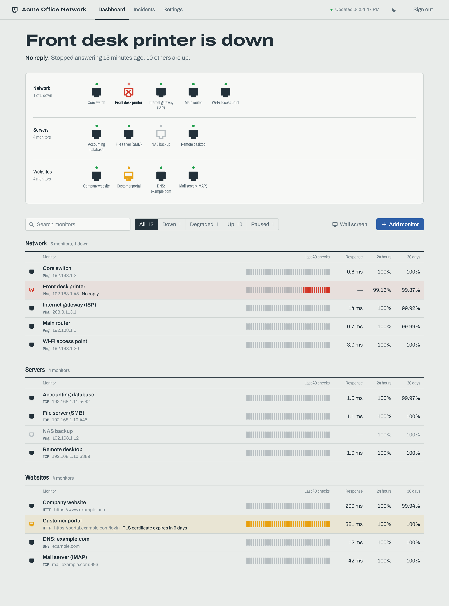
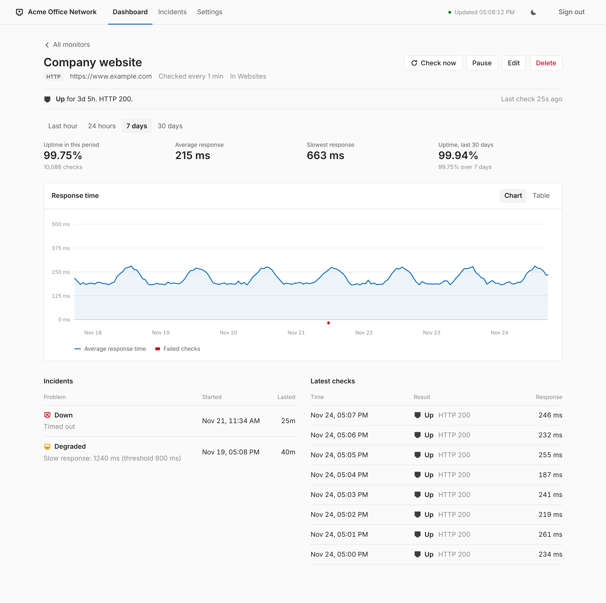
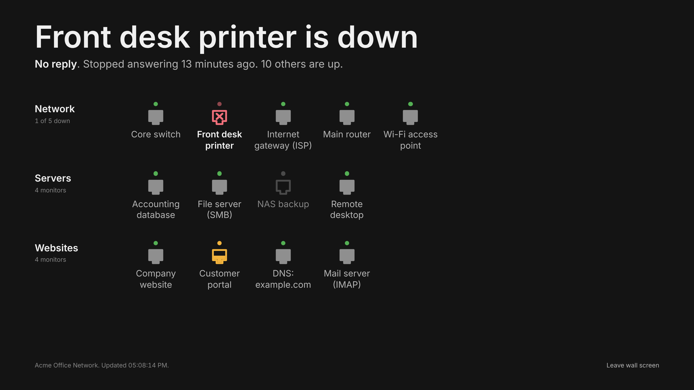
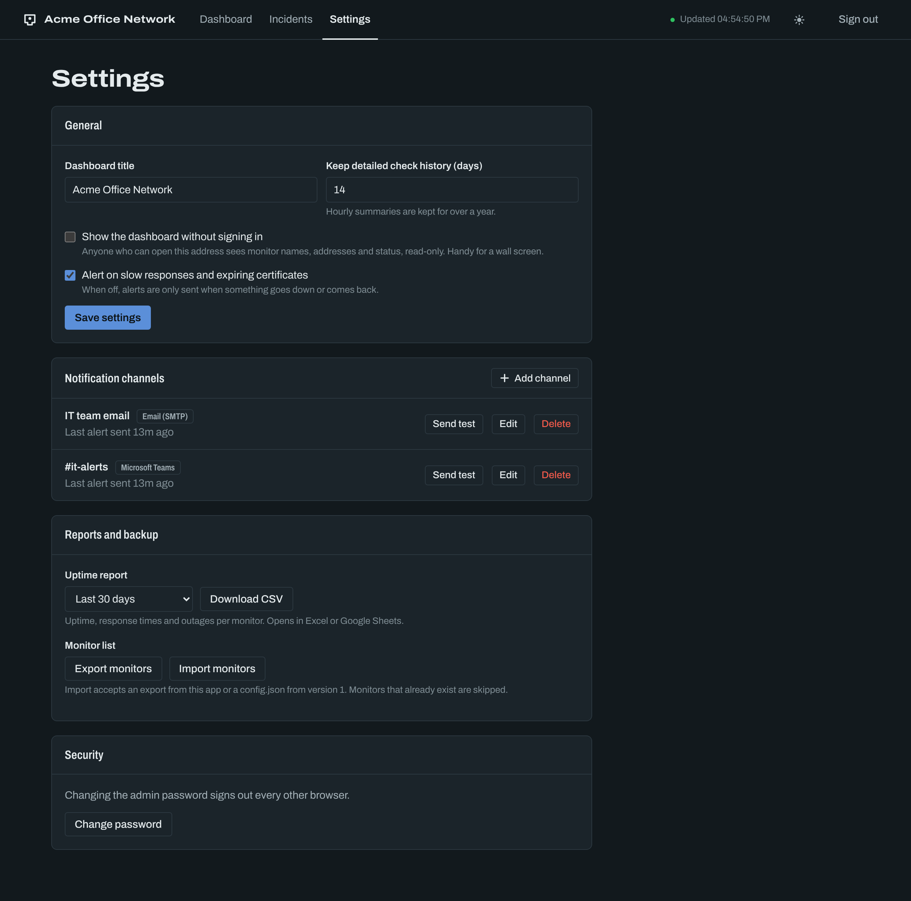

# Network Health Monitor

Self-hosted uptime monitoring for small networks. It checks your routers, servers, printers
and websites around the clock, keeps the history, and tells you by email or chat when
something goes down and when it comes back.

It runs as one small program on any always-on machine (a spare PC, a NAS, a Raspberry Pi,
a small VM) and is used from a web browser. There is no cloud account, no agent to install on
the devices you monitor, and no per-device licence.



## What it does

- **Four kinds of checks**
  - **Ping (ICMP)**: is a device reachable? Routers, switches, access points, printers.
  - **TCP port**: is a service accepting connections? Remote desktop, file shares, databases, mail.
  - **Website / HTTP(S)**: does a page load with the right status code and, optionally, contain
    the text you expect? Warns before the TLS certificate expires.
  - **DNS lookup**: does a name resolve, optionally to the address you expect?
- **Alerts that are not noisy.** A failure must repeat (two retries by default) before anyone
  is told, so one dropped packet never sends an alert. Recovery is reported at once, with how
  long the outage lasted.
- **Alert channels:** email (SMTP), Slack, Microsoft Teams, Discord, Telegram and a generic
  JSON webhook. Each has a "Send test" button.
- **History and reports:** response-time charts for the last hour, day, week and month, uptime
  percentages, an incident log, and a CSV uptime report for Excel or Google Sheets.
- **Everything is managed in the browser.** Add, edit, pause and delete monitors and group
  them (Network, Servers, Websites...). No config files to edit.
- **Wall screen:** a full-screen view for a TV or spare monitor in the office, readable from
  across the room. Combine it with "Show the dashboard without signing in" so the screen needs
  no password.
- Light and dark themes; works on a phone.

Every monitor appears as a port on a patch panel. A connected port is dark with a green
light; a port that stops answering empties and its light turns red, so a problem is visible
at a glance. Status is always shown by shape as well as colour.





## Quick start

You need Python 3.10 or newer.

```bash
git clone https://github.com/gpparinas/ICMP-GUI-Monitoring.git
```

```bash
cd ICMP-GUI-Monitoring
```

```bash
pip install .
```

```bash
netmon run --open
```

The dashboard opens at <http://localhost:8080>. On the first visit you choose an admin
password, then add your first monitor.

By default the dashboard is only reachable from the machine it runs on. To use it from other
computers on your network:

```bash
netmon run --host 0.0.0.0
```

Then browse to `http://<that-machine's-IP>:8080`.

### Docker

```bash
docker compose up -d
```

Data is kept in the `netmon-data` volume. The dashboard is at <http://localhost:8080>.

## Running it permanently

Monitoring is only useful if it is always running, so install it as a service on a machine
that stays on.

**Linux (systemd):** see [`deploy/netmon.service`](deploy/netmon.service). The steps are in
the comments at the top of the file.

**Windows:** install with `pip install .` and create a scheduled task that runs at startup.
From an Administrator command prompt (adjust the path to where `netmon.exe` was installed;
`where netmon` shows it):

```bat
schtasks /Create /TN "Network Health Monitor" /SC ONSTART /RU SYSTEM /TR "\"C:\Path\To\netmon.exe\" --data-dir C:\ProgramData\netmon run --host 0.0.0.0"
```

**Docker:** the compose file already restarts the container automatically.

## Upgrading from version 1

Version 1 was a desktop window (`Ping_Monitoring.py`) that read `config.json`. Your devices
and websites carry over:

```bash
netmon import config.json
```

or use **Settings → Reports and backup → Import monitors** in the dashboard. Entries under
`ip_addresses` become ping monitors in a "Network Devices" group, entries under
`web_services` become website monitors in "Web Services", and `alert_threshold` becomes the
slow-response warning. The old sample file is kept at
[`examples/config.v1.json`](examples/config.v1.json).

## Command line

| Command | What it does |
| --- | --- |
| `netmon run [--host H] [--port P] [--open]` | Start the monitor and dashboard (the default command). |
| `netmon import FILE` | Add monitors from an export or a version 1 `config.json`. |
| `netmon export [FILE]` | Write all monitor definitions as JSON (a backup you can re-import). |
| `netmon set-password` | Set or reset the admin password, for example if it was forgotten. |

`--data-dir DIR` goes before the command (`netmon --data-dir /srv/netmon run`) and chooses
where the database and log file live.

| Environment variable | Default | Purpose |
| --- | --- | --- |
| `NETMON_HOST` | `127.0.0.1` | Address to listen on. |
| `NETMON_PORT` | `8080` | Port to listen on. |
| `NETMON_DATA_DIR` | per-user data folder | Where `netmon.db` and `netmon.log` are stored. |
| `NETMON_ADMIN_PASSWORD` | unset | Sets the admin password on first start, instead of the browser setup screen. |

## How status is decided

| Status | Meaning |
| --- | --- |
| **Up** | The last check passed. |
| **Degraded** | Reachable, but slower than the monitor's "slow response" threshold, or its TLS certificate is about to expire. |
| **Down** | The check failed, and kept failing through all retries. |
| **Paused** | Checking is switched off for this monitor. |
| **Pending** | Waiting for the first result. |

While a failure is unconfirmed the monitor is re-checked every 10 seconds, so with the
default of two retries an outage is confirmed in roughly 20 to 30 seconds. Uptime percentages
count degraded checks as reachable.

Detailed check results are kept for 14 days (configurable in Settings). Hourly summaries are
kept for over a year, so monthly and yearly uptime figures survive the clean-up.

## Notes on ping

Sending ICMP normally needs special rights. The monitor picks the best method available and
logs which one it chose at start-up (`ICMP mode: ...`):

- **Linux and macOS:** unprivileged ICMP sockets where the system allows them, raw sockets when
  running as root or with `CAP_NET_RAW` (the systemd unit grants this), otherwise the system
  `ping` command.
- **Windows:** the built-in `ping` command, so no Administrator rights are needed.



## Security

- All changes need the admin password. Passwords are stored as scrypt hashes; sessions are
  HttpOnly, SameSite=Strict cookies; repeated wrong passwords are throttled.
- The first person to open a fresh install chooses the admin password. On a shared network,
  either do that straight away or set `NETMON_ADMIN_PASSWORD` before the first start.
- SMTP passwords, bot tokens and webhook URLs are stored in the local database so alerts can
  be sent. They are never sent back to the browser. Protect the data folder like any other
  file containing credentials.
- The built-in server speaks plain HTTP. If the dashboard must be reachable from the internet,
  put it behind a reverse proxy with HTTPS (Caddy, nginx, Traefik) and make sure the proxy
  passes the original `Host` header.
- "Show the dashboard without signing in" exposes monitor names, addresses and status,
  read-only, to anyone who can reach the page. It is off by default.

## Development

```bash
pip install -e ".[dev]"
```

```bash
pytest
```

```bash
ruff check .
```

Layout:

```
src/netmon/
  checks.py     ping, TCP, HTTP and DNS checks
  engine.py     scheduler, up/degraded/down state machine, incidents
  notify.py     email, Slack, Teams, Discord, Telegram, webhook delivery
  db.py         SQLite storage, hourly roll-ups, retention
  api.py        FastAPI application (JSON API + static dashboard)
  auth.py       password hashing, sessions, login throttling
  importer.py   export / import, including the version 1 config.json
  cli.py        the netmon command
  static/       dashboard (plain HTML, CSS and JavaScript, no build step)
tests/          pytest suite
```

The dashboard has no external dependencies and makes no requests to other sites, so it works
on a network with no internet access. Its typeface, [Archivo](https://github.com/Omnibus-Type/Archivo),
is bundled in `static/fonts/` under the SIL Open Font License.

## Ideas for later

- Maintenance windows (planned downtime that does not alert or count against uptime).
- One combined alert when the monitoring machine itself loses its network, instead of one per monitor.
- Choosing which channels each monitor alerts, and repeat reminders for long outages.
- Several user accounts with read-only and admin roles.
- SNMP checks (bandwidth, printer toner, UPS battery).
- A public status page for customers.

## License

MIT. See [LICENSE](LICENSE).
